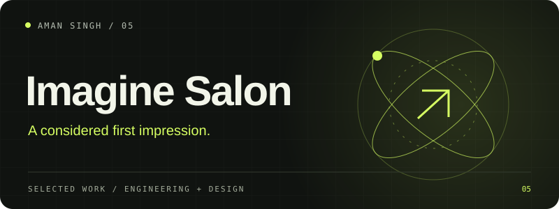

# Imagine Salon

A responsive five-page salon website connecting service discovery, bridal work and direct booking paths.

**HTML / CSS / JavaScript**

## What is included

Includes navigation, service and bridal pages, FAQ interactions, a testimonial slider and a lazy-loaded map. Booking uses external contact services; there is no custom booking database or payment system.

## Local setup

Run `python -m http.server 8080` from this folder and open `http://localhost:8080`. Replace business contact details and third-party imagery with content you are authorized to use before adapting the design.

## Source and configuration

This repository is a source release. Local credentials, session cookies, personal records, databases, dependency directories and generated build files are excluded. See [SECURITY.md](SECURITY.md) before configuring integrations or contributing.

Current integration availability and physical-device behavior must be verified in your own environment. Historical project checks are not a promise that every external service works today.

---

Built by [Aman Singh](https://github.com/aman-singh27) · [More work](https://github.com/aman-singh27/aman-singh27/blob/main/PROJECTS.md)
